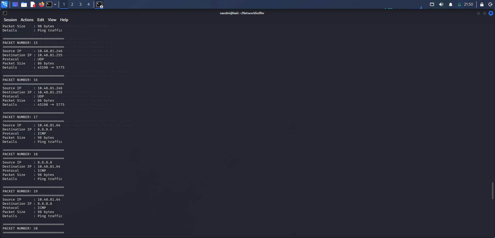
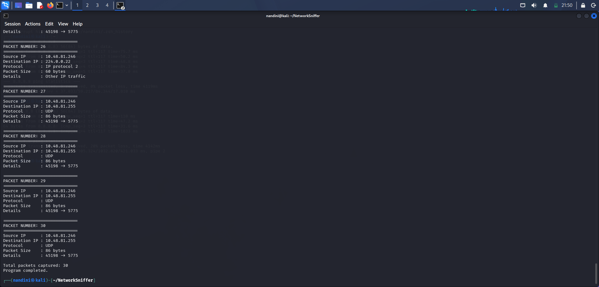

# Python-Based Network Packet Sniffer and Analyzer

## 1. Introduction
This project is a Python-based Network Packet Sniffer and Analyzer developed using Kali Linux and Scapy. It captures and analyzes network packets and displays useful information about network communication.

## 2. Objectives
- Capture live network packets.
- Identify TCP, UDP and ICMP protocols.
- Display source and destination IP addresses.
- Display packet size and port numbers.
- Understand how network communication works.

## 3. Technologies Used
- Python
- Scapy
- Kali Linux
- Wireshark
- Git and GitHub

## 4. Project Features
- Live packet capturing.
- Protocol identification.
- Source and destination IP address detection.
- TCP and UDP port identification.
- Packet size analysis.

## 5. Installation

Install the required library:

```bash
pip install -r requirements.txt
```

## 6. How to Run

```bash
sudo python3 sniffer.py
```

## 7. Expected Output
The program displays captured packets with:
- Packet number
- Source IP
- Destination IP
- Protocol
- Packet size
- Source and destination ports (where applicable)
## 8. Screenshots

### ICMP Packet Capture


### UDP Packet Capture


## 9. Conclusion
This project provides practical knowledge of network packet capturing, protocol analysis and network communication using Python and Scapy.

## 10. Author
Developed as an academic Computer Networks project.

